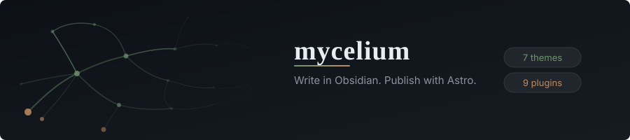
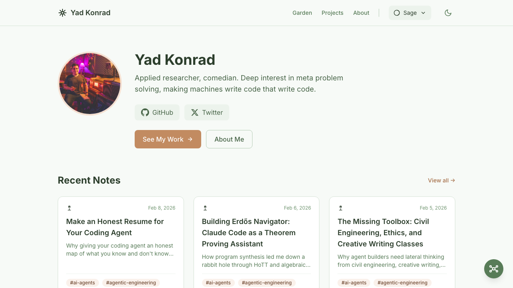
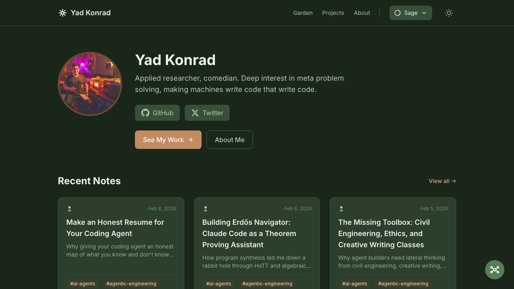
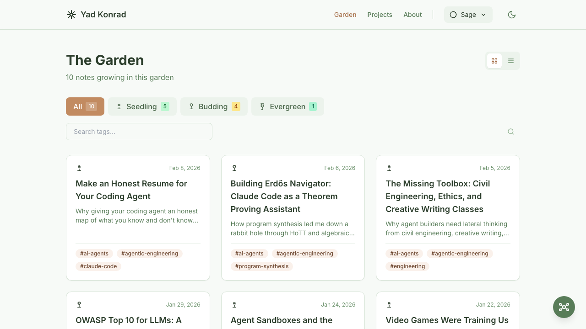

<p align="center">
  
</p>

<p align="center">
  <strong>Write in Obsidian. Publish with Astro.</strong>
</p>

<p align="center">
  <a href="https://yad.codes">Live Demo</a> &middot;
  <a href="#quick-start">Quick Start</a> &middot;
  <a href="#configuration">Configuration</a> &middot;
  <a href="#writing-content">Writing Content</a> &middot;
  <a href="#deploy">Deploy</a> &middot;
  <a href="#receiving-theme-updates">Theme Updates</a>
</p>

<p align="center">
  
  
  
  
</p>

---

<p align="center">
  
  
</p>

<p align="center">
  
</p>

## Why Mycelium

One repo, two tools. Write in Obsidian, publish with Astro, no copy-paste in between. Wikilinks (`[[links]]`), backlinks, and a D3 graph view all work without configuration. Theme and content stay in separate lanes, so `npm run update-theme` pulls upstream changes without touching your posts. 9 custom Obsidian plugins handle templates, SEO, theming, and focus mode.

## What You Get

7 color themes: Sage, Ocean, Sunset, Minimal, Nord, Rose, Forest.

9 custom Obsidian plugins -- mycelium-climate (theme switcher), mycelium-focus (single-tab writing), mycelium-garden (setup wizard), mycelium-spore (content templates), mycelium-trace (filename aliases), mycelium-signal (SEO panel), mycelium-label (title display), mycelium-prune (UI customization), mycelium-network (card view). 8 community plugins are also pre-configured, including obsidian-git for version control.

On the Astro side: wikilink support with anchors, callout blocks, D3 graph visualization, command palette (`Ctrl+K`), backlinks, growth indicators (seedling/budding/evergreen), dark/light mode, RSS feed, sitemap, OG image generation.

Four content types: posts, pages, projects, docs.

## Quick Start

Requires **Node 22.12+** (Astro 7).

```bash
git clone https://github.com/0bserver07/mycelium-theme my-garden
cd my-garden
npm install
npm run setup    # Configure your site name, URL, git remote
npm run dev      # Start dev server at localhost:4321
```

**Obsidian vault:** Open `src/content/` in Obsidian (not the repo root).

After opening in Obsidian:
1. Settings > Community plugins > Turn off Restricted mode
2. Plugins auto-enable

## Project Structure

```
mycelium-theme/
├── src/
│   ├── content/           <- Open this folder as your Obsidian vault
│   │   ├── .obsidian/     # Plugins & settings (pre-configured)
│   │   ├── posts/         # Blog posts
│   │   ├── pages/         # Static pages
│   │   ├── projects/      # Project showcases
│   │   └── docs/          # Documentation
│   ├── components/        # Astro UI components
│   ├── layouts/           # Page layouts
│   ├── pages/             # Route definitions
│   ├── styles/            # Global CSS (Tailwind)
│   ├── themes/            # Color theme definitions
│   ├── utils/             # Remark/Rehype plugins
│   └── config.ts          # Site configuration
├── scripts/               # Setup, OG generation, theme update
└── package.json
```

## Deploy

Mycelium builds to static files. Deploy anywhere that serves HTML.

### Netlify

[](https://app.netlify.com/start/deploy?repository=https://github.com/0bserver07/mycelium-theme)

Or connect your repo in the Netlify dashboard. Build command: `npm run build`, publish directory: `dist/`.

### Vercel

```bash
npm i -g vercel
vercel
```

Or import the repo at [vercel.com/new](https://vercel.com/new). Framework preset: Astro.

### GitHub Pages

Add this workflow at `.github/workflows/deploy.yml`:

```yaml
name: Deploy to GitHub Pages
on:
  push:
    branches: [master]

jobs:
  build:
    runs-on: ubuntu-latest
    steps:
      - uses: actions/checkout@v4
      - uses: actions/setup-node@v4
        with:
          node-version: 22
      - run: npm ci
      - run: npm run build
      - uses: actions/upload-pages-artifact@v3
        with:
          path: dist/
  deploy:
    needs: build
    runs-on: ubuntu-latest
    permissions:
      pages: write
      id-token: write
    environment:
      name: github-pages
    steps:
      - uses: actions/deploy-pages@v4
```

Set `site` in `src/config.ts` to your GitHub Pages URL.

## Configuration

Edit `src/config.ts`:

```typescript
export const siteConfig = {
  site: 'https://your-site.com',
  name: 'My Digital Garden',
  gardener: 'Your Name',
  description: 'Your garden description',
  // ...
};
```

Run `npm run setup` for an interactive walkthrough.

## Writing Content

Create files in `src/content/posts/` (or use the `mycelium-spore` plugin in Obsidian):

```yaml
---
title: My First Note
description: A brief description
growth: seedling
planted: 2025-12-16
lastTended: 2025-12-16
tags: [topic, subtopic]
draft: false
---

# Your Content

Use [[wikilinks]] to connect notes!

> [!tip] Pro Tip
> Callouts work like in Obsidian.
```

### Growth status

Growth auto-calculates from backlinks but can be set manually. Seedling means a new idea or rough draft, budding means it's developing with some connections, and evergreen means mature and well-connected.

## Commands

| Command | Action |
|---------|--------|
| `npm install` | Install dependencies |
| `npm run setup` | Configure site name, URL, socials |
| `npm run dev` | Development server (localhost:4321) |
| `npm run build` | Build to `./dist/` |
| `npm run preview` | Preview production build |
| `npm run generate-og` | Generate OG images for posts |
| `npm run update-theme` | Pull latest theme updates |

## Recommended Workflow

1. **Write** in Obsidian (`src/content/`)
2. **Preview** with `npm run dev`
3. **Commit** with obsidian-git or terminal
4. **Deploy** to Netlify/Vercel/GitHub Pages

## Receiving Theme Updates

Your garden receives upstream theme updates without losing your content:

```bash
npm run update-theme
```

The script automatically:
1. Adds the upstream remote (first time only)
2. Stashes your local changes
3. Fetches and merges theme updates
4. Restores your changes

### Manual Workflow

```bash
git remote add upstream https://github.com/0bserver07/mycelium-theme.git  # first time
git stash push -u                    # Stash your changes (including untracked)
git fetch upstream                   # Get latest theme updates
git merge upstream/master            # Merge theme updates
git stash pop                        # Restore your content
```

### Why This Works

The repo separates **theme files** from **user content**:

| Type | Files | Who Modifies |
|------|-------|--------------|
| **Theme** | `src/components/`, `src/layouts/`, `src/pages/`, `src/styles/` | Upstream only |
| **User Content** | `src/content/posts/`, `src/content/pages/`, `src/content/projects/` | You only |
| **User Config** | `src/config.ts` | You only |
| **Shared** | `src/content/.obsidian/` | Both (plugins update upstream) |

Theme updates merge cleanly because you don't edit theme files. Content conflicts are rare because upstream doesn't touch your posts.

## Draft Content

Two ways to keep work-in-progress out of production, depending on whether it
lives in your garden yet.

**In-vault drafts** -- a post in `src/content/posts/` with `draft: true` in its
frontmatter:
- **Dev** (`npm run dev`): visible, so you can preview while writing
- **Production** (`npm run build`): hidden -- not published

**Out-of-vault drafts** -- Markdown in the top-level `drafts/` folder, kept
entirely outside the Obsidian vault (so it never touches backlinks, the graph,
or search):
- Preview at **`/drafts-preview`** (index) or **`/drafts-preview/<file>`** while
  running `npm run dev` -- rendered through the real `PostLayout`, so a draft
  looks exactly like a published post.
- Emits **nothing** in `npm run build`: no HTML, no sitemap entry, no OG image.
  The preview route returns an empty path list in production.
- Promote when ready: `git mv drafts/my-post.md src/content/posts/`.

See `drafts/README.md` for details. Relocate the folder by changing `DRAFTS_DIR`
in `src/content.config.ts`.

## Troubleshooting

### "No plugins found" in Obsidian
You opened the repo root. Close Obsidian, then open `src/content/` specifically.

### Tags/pages return 404 in dev
Check that your posts have `draft: false` or that you're testing with dev server (drafts visible in dev mode only).

### BRAT keeps downloading old plugins
Clear `src/content/.obsidian/plugins/obsidian42-brat/data.json` -- set `pluginList` and `themesList` to empty arrays.

### Merge conflicts on update
If you accidentally edited theme files, use:
```bash
git checkout --theirs src/components/  # Accept upstream theme changes
git add .
git commit -m "Resolve merge conflicts, accept upstream theme"
```

## Built With

- [Astro](https://astro.build) -- static site generator
- [Obsidian](https://obsidian.md) -- content authoring
- [Tailwind CSS](https://tailwindcss.com) -- styling
- [D3.js](https://d3js.org) -- graph visualization
- [Fuse.js](https://www.fusejs.io) -- fuzzy search

## Contributing

See [CONTRIBUTING.md](CONTRIBUTING.md) for guidelines.

## License

[MIT License](LICENSE)
